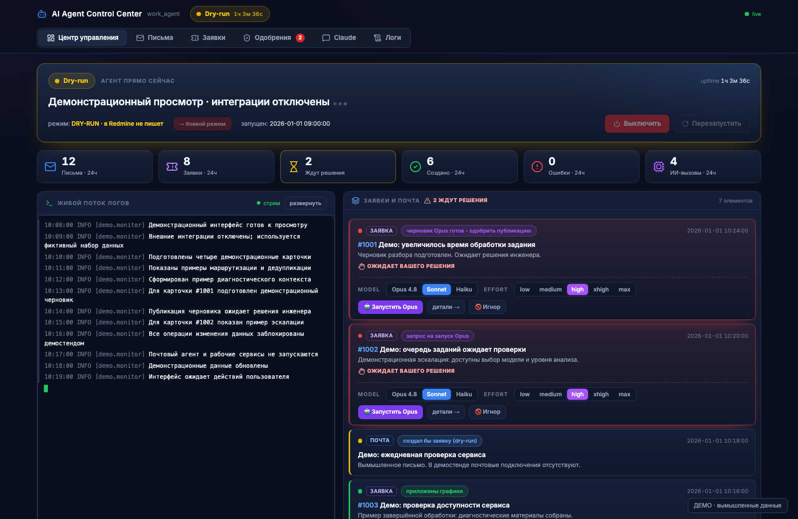
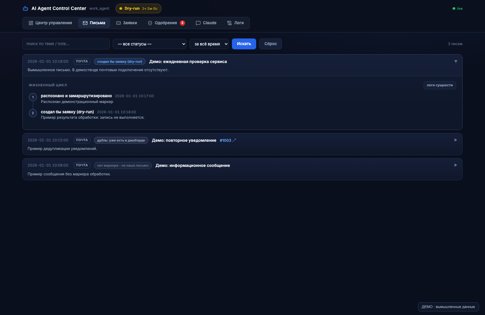
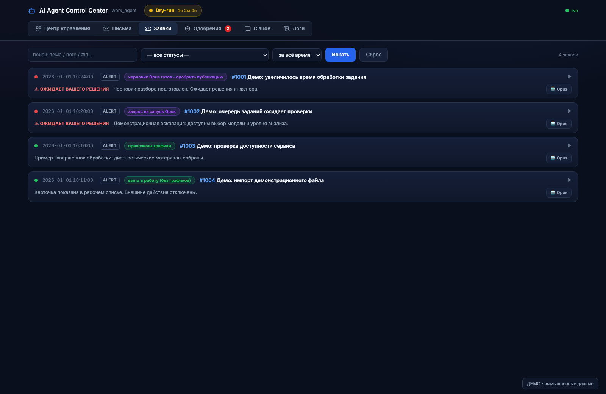
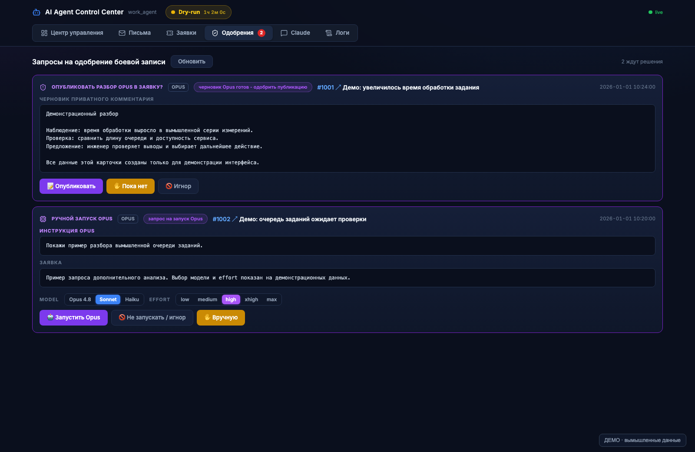
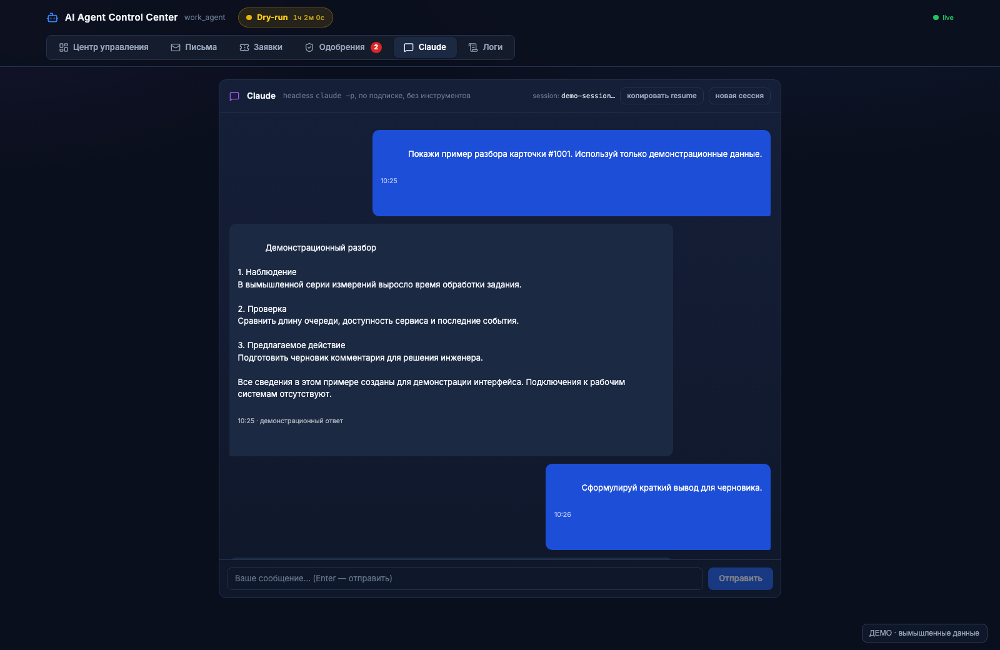

# RedmineSupportTool

Python-агент для автоматизации техподдержки: почтовые алерты, заявки Redmine, мониторинг Grafana и локальный веб-дашборд.

Это обезличенная версия проекта. Все обозначения клиентов, площадок, проектов и инженеров в исходниках и тестах — примеры. Рабочие конфиги, учётные данные, графики сотрудников, журналы, вложения, заявки, метрики и материалы расследований в репозиторий не включены.

## Интерфейс

Скриншоты сняты на отдельном статическом демостенде. Все письма, заявки, показатели, черновики и сообщения вымышлены.



| Письма | Заявки |
| --- | --- |
|  |  |

| Одобрения | Чат |
| --- | --- |
|  |  |

Для просмотра интерфейса достаточно Python 3.10 или новее; зависимости и рабочие конфиги не нужны:

```bash
python3 tools/screenshot_demo.py
```

Откройте адрес, который напечатает скрипт. Демостенд использует новый свободный порт на `127.0.0.1`, отдаёт только статические файлы и фиктивные ответы API. Он не запускает агента и не импортирует почтовые, Redmine, SQL и другие интеграции. Запросы на изменение данных возвращают HTTP 405. Для остановки нажмите Ctrl+C.

## Возможности

- Получение писем по IMAP и обработка алертов по настраиваемым правилам.
- Маршрутизация заявок, дедупликация, роли инженеров и график смен.
- Разбор алертов Grafana и чтение метрик InfluxDB.
- Ограниченный доступ к SQL Server через операции чтения.
- Подготовка черновиков с помощью CLI-модели и отдельное одобрение публикации человеком.
- Локальный дашборд: заявки, письма, черновики, чат, управление и журналы.
- Дополнительные уведомления через Telegram или ntfy.

## Установка

Проверено на Python 3.14. Для почтовой ветки используются библиотеки Python; дашборд и мониторинг требуют дополнительные зависимости.

```bash
python3 -m venv .venv
.venv/bin/python -m pip install -r requirements.txt -r tools/dashboard/requirements.txt
cp config/config.example.json config/config.json
cp config/secrets.example.json config/secrets.local.json
cp config/grafana_sets.example.yml config/grafana_sets.yml
cp config/shift_schedule.example.json config/shift_schedule.json
cp config/table_analysis.example.json config/table_analysis.json
```

Заполните локальные файлы параметрами своей среды. Домены `example.invalid`, адреса из диапазона документации, имена `Engineer` и обозначения `CLIENT`/`CLB`/`CLC`/`CLD` служат примерами. В конфиге по умолчанию включён `dry_run`, а интеграции отключены. Даже `dry_run` может читать подключённые сервисы, поэтому до подключения нужно настроить адреса и учётные данные.

```bash
.venv/bin/python run_agent.py --once
.venv/bin/python run_agent.py --loop
tools/dashboard/run.sh
```

Дашборд слушает `127.0.0.1:8765`. Для выбора Python можно задать `AGENT_PYTHON`; первый аргумент скрипта задаёт порт. Флаг `--live` принудительно включает изменения в подключённом Redmine.

## Конфигурация

Схема параметров находится в `agent/config_schema.py`, шаблоны — в `config/`. [Описание локальной настройки](config/README.md) объясняет роли, подключения и обязательные замены примеров.

Примерные карты площадок в `agent/grafana_sets.py` и шаблоны хостов в `agent/service_verdict.py` нужно заменить картами своей среды. Для поиска кода требуется установленный `codebase-memory-mcp` и настроенные проекты графа. Для AI-анализа используется установленный CLI `claude` либо настроенный API-провайдер. При использовании SQL нужны FreeTDS/`tsql`; для рендера Grafana — совместимый браузер.

Учётные данные хранятся в `config/secrets.local.json`, который игнорируется Git. MCP-запускаторы `redmine_ro_launch.py` и `influx_mcp_launch.py` читают локальную конфигурацию; `agent/sql_mcp.py` получает параметры подключения через переменные `WA_DB_*`.

## Проверка

```bash
.venv/bin/python -m pip install -r requirements-dev.txt
.venv/bin/python -m pytest tests tools/dashboard/test_dashboard.py -q
.venv/bin/python tools/check_public_tree.py
gitleaks dir . --redact=100
```

Тесты используют временные каталоги и подменённые сервисы. Перед коммитом проверяйте именно список публикуемых файлов: `.gitignore` не удаляет уже отслеживаемые секреты. Для проверки индекса Git выполните `python tools/check_public_tree.py --staged` и `gitleaks git . --log-opts=--all --redact=100`.

## Структура

```text
agent/                   Оркестратор, обработчики, клиенты сервисов и MCP
tools/dashboard/         Локальный веб-дашборд
tools/control_center.py  Построение событий и чтение журналов
tools/check_public_tree.py  Проверка публикуемых путей и адресов
tools/screenshot_demo.py  Статический демостенд без подключений к рабочим сервисам
config/*.example.*       Пустые и демонстрационные настройки
tests/                   Проверки с подменёнными сервисами
documentation/           Общие инструкции без рабочих данных
run_agent.py             Запуск агента
```

Файлы `config/config.json`, `config/secrets.local.json`, другие рабочие файлы в `config/`, каталоги `state/`, `logs/`, `attachments/` и локальные истории диалогов не должны попадать в Git.
